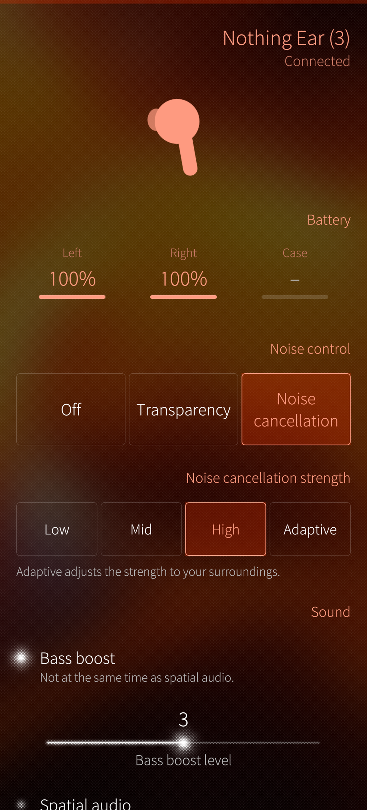
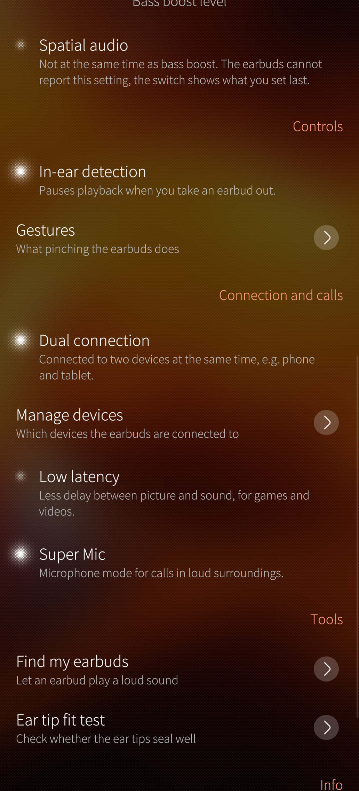
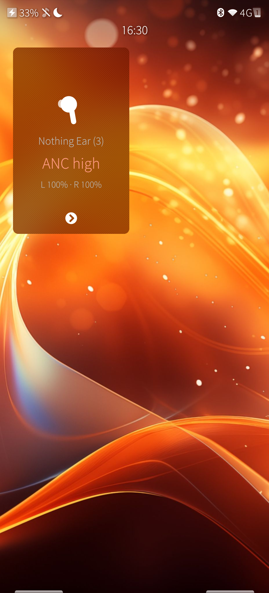

# Pinch

Companion app for Nothing earbuds on Sailfish OS: noise control, battery,
gestures and the other settings of the Nothing X app.

<p align="center">
  
  
  
  
</p>

## Features

- **Noise control:** off, transparency or noise cancellation with the
  strength low, mid, high or adaptive; follows changes made with the pinch
  gesture on the buds
- **Battery** of the left and right earbud and the case, with charging state
- **App cover** with the current mode, battery and a button for the next mode
- **Connects the earbuds** from the app (pull-down menu, cover, optionally on
  start) and opens the control channel as soon as they are connected
- **Gestures** per side: double/triple pinch, pinch and hold, double pinch and
  hold – including which modes "noise control" switches between
- **Find my earbuds:** let the left or right earbud ring
- **Ear tip fit test**
- **Dual connection:** switch it on or off and choose which remembered devices
  are connected
- **Depending on the model:** personalized noise cancellation, bass boost with
  five levels, spatial audio, in-ear detection, low latency, Super Mic
- **Info:** model, firmware and serial number
- Models without noise control (e.g. Ear (open)) show the battery and the
  other settings only

See [Compatibility](#compatibility) for which features each model supports
and what has been tested.

Pinch is an unofficial app and not affiliated with Nothing Technology.
"Nothing" and the product names are trademarks of their owner.

## Compatibility

Pinch is meant for Nothing and CMF earbuds that work with the Nothing X app.
The table lists the models I own and could test myself – it is not a list of
the only supported models.

✅ tested and working · 🔸 should work, not tested yet · – not available on this model

| Feature | Ear (2) | Ear (3) | Ear (open) |
|---|:-:|:-:|:-:|
| Control channel, connects when the earbuds connect | ✅ | ✅ | 🔸 |
| Connect the earbuds from the app / on start | 🔸 | 🔸 | 🔸 |
| Noise control: off, transparency, noise cancellation | ✅ | ✅ | – |
| Noise cancellation strength (low, mid, high, adaptive) | ✅ | ✅ | – |
| Personalized noise cancellation | 🔸 | ✅ | – |
| Battery left, right, case | ✅ | ✅ | 🔸 |
| App cover (mode, battery, next mode) | 🔸 | ✅ | 🔸 |
| Bass boost (5 levels) | – | ✅ | – |
| Spatial audio | – | ✅ | – |
| Super Mic | – |✅ | – |
| In-ear detection | 🔸 | ✅ | – |
| Low latency | 🔸 | 🔸 | 🔸 |
| Gestures | 🔸 | ✅ | 🔸 |
| Find my earbuds | 🔸 | ✅ | 🔸 |
| Ear tip fit test | 🔸 | ✅ | – |
| Dual connection and device list | 🔸 | ✅ | 🔸 |
| Model, firmware, serial number | ✅ | ✅ | ✅ |

Tested on a Jolla Phone with Sailfish OS 5.1, Pinch 1.0.0.

Over-ear headphones (e.g. Headphone (1)) show one battery value instead of
left, right and case; their button controls are not supported yet.

**Other models** (Ear (1), Ear (a), Ear (stick), CMF Buds, Headphone (1), …)
use the same protocol and should work as well – please try it and tell me how
it went, then I add a column for your model. Pinch only shows a setting when
the earbuds answer for it, so trying does no harm.

### Feedback welcome

Does a feature work – or not – on your earbuds? Please tell me, so the table
gets better:

- open an [issue on GitHub](https://github.com/t-sappl/harbour-pinch/issues)
  or write a comment on OpenRepos
- name the model and the firmware (Pinch shows both under "Info")
- if something fails: start Pinch in a terminal with `harbour-pinch` and add
  the output

## Usage

1. Pair the earbuds in the Bluetooth settings of Sailfish OS.
2. In Pinch: pull down → **Choose earbuds**.
3. If connecting fails with "control service not found", set the RFCOMM
   channel by hand in the settings (on a PC: `sdptool search --bdaddr <address> SP`).

## How it works

The earbuds expose a vendor control channel over Bluetooth RFCOMM
(service UUID `aeac4a03-dff5-498f-843a-34487cf133eb`). Pinch lists paired
devices through BlueZ on D-Bus, waits until the system has connected the
earbuds for audio, and then opens the control channel. For that it registers
an `org.bluez.Profile1` client for the service UUID and calls
`Device1.ConnectProfile`; BlueZ finds the RFCOMM channel and hands over the
socket. Optionally a fixed channel can be set, then a plain RFCOMM socket is
used. Only QtDBus is needed, no QtBluetooth.

Packets look like this (little endian):

```
55 60 01 | cmd (2) | len | 00 | op id | payload | CRC-16/MODBUS (2)
```

| Purpose            | Command  | Payload              |
|--------------------|----------|----------------------|
| Read ANC           | `0xC01E` | –                    |
| Set ANC            | `0xF00F` | `01 <code> 00`       |
| ANC report         | `0xE003` / `0x401E` | `xx <code> …` |
| Read battery       | `0xC007` | –                    |
| Battery report     | `0xE001` / `0x4007` | `count, (id, level)…` |
| Serial / firmware  | `0xC006` / `0xC042` | reply `0x4006` / `0x4042` |
| In-ear detection   | `0xC00E`, set `0xF004` | set `01 01 <on>`, reply `0x400E` byte 2 |
| Low latency        | `0xC041`, set `0xF040` | set `01 00` on / `02 00` off |
| Gestures           | `0xC018`, set `0xF003` | set `01 <side> <common> <type> <action>` |
| Personalized ANC   | `0xC020`, set `0xF011` | `<on>` |
| Bass boost         | `0xC04E`, set `0xF051` | `<on> <level × 2>` |
| Spatial audio      | set `0xF052` | `<on> 00` (no read) |
| Super Mic          | `0xC05E`, set `0xF05F` | `<on>` |
| Ring               | `0xF002` | `<side> <on>` |
| Fit test           | `0xF014` | `01`, result `0xE00D` `<left> <right>` |
| Dual connection    | `0xC027`, set `0xF01A` | `<on>`; devices `0xC028 <offset>` → `0x4028`, connect `0xF01B <on> <mac>` |

Battery ids: `02` left, `03` right, `04` case; level bit 7 = charging, bits 0–6 = percent.

ANC codes: `01` high, `02` mid, `03` low, `04` adaptive, `05` off, `07` transparency.

## Building

Use the Sailfish SDK (Qt 5.6, Silica):

```
sfdk config target=SailfishOS-<version>-aarch64
sfdk build
```

The protocol code has no Qt dependency and comes with tests that run on any PC:

```
cd tests
g++ -std=c++11 -Wall -Wextra -I../src ../src/nothingprotocol.cpp protocol_test.cpp -o protocol_test
./protocol_test
```

## Structure

| Folder | Content |
|---|---|
| `src/nothingprotocol.*` | Packet format, CRC and all commands, plain C++ without Qt |
| `src/` | BlueZ profile and RFCOMM socket, device list, controller for QML, model table |
| `qml/` | Silica user interface |
| `tests/` | Protocol tests that run on any PC |
| `design/` | SVG sources of the app icon and the earbud illustrations |

Design decisions: [`DESIGN.md`](DESIGN.md) (German); changes:
[`CHANGELOG.md`](CHANGELOG.md).

## Privacy

See [`PRIVACY.md`](PRIVACY.md). In short: Pinch has no internet access and
sends nothing anywhere.

## Credits

The protocol knowledge comes from the community projects
[ear-web](https://github.com/radiance-project/ear-web) and
[earctl](https://github.com/DaanHessen/earctl). Pinch is an independent
implementation in C++.

## License

GPL-3.0-or-later, see [`LICENSE`](LICENSE). © 2026 Thomas Sappl.
